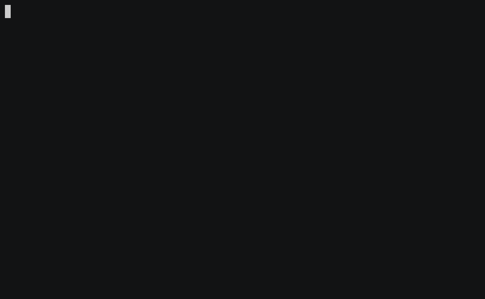

# GO2DIR

[](https://github.com/alexandreprates/go2dir/actions/workflows/test.yml)

A simple way to navigate to your favorite directories.



## How to install

Install go2dir:

```bash
$ curl https://raw.githubusercontent.com/alexandreprates/go2dir/master/install | bash
```

## How to use

Add a directory to the go2 list:

```bash
$ go2 -a <path> [<name>]
```

Map the name `development` to `/home/someuser/workspace/development`:

```bash
$ cd /home/someuser/workspace/development
$ go2 -a .
Mapping development to /home/someuser/workspace/development
```

Map the name `dev` to `/home/someuser/workspace/development`:

```bash
$ cd /home/someuser/workspace/development
$ go2 -a . dev
Mapping dev to /home/someuser/workspace/development
```

Navigate to a mapped directory from anywhere:

```bash
$ go2 development
Going to development at /home/someuser/workspace/development

$ go2 dev
Going to dev at /home/someuser/workspace/development
```

Spaces in the automatically generated name are replaced with hyphens:

```bash
$ cd /home/someuser/workspace/some\ dir\ with\ spaces
$ go2 -a .
Mapping some-dir-with-spaces to /home/someuser/workspace/some dir with spaces
```

Navigate to the directory using its generated name:

```bash
$ go2 some-dir-with-spaces
Going to some-dir-with-spaces at /home/someuser/workspace/some dir with spaces
```

List mapped directories:

```bash
$ go2 -l
Current locations

            dev -> /home/someuser/workspace/development
    development -> /home/someuser/workspace/development
some-dir-with-spaces -> /home/someuser/workspace/some dir with spaces

```

Remove a mapped directory:

```bash
$ go2 -R development
development was successfully removed
```

## Names and storage

Aliases are stored literally and may contain spaces or punctuation. Quote such
names when invoking the shell. Use `go2 -- NAME` to navigate to an alias that
starts with a hyphen. Names and paths containing newlines or carriage returns
are rejected because mappings use one record per line.

Writers coordinate through `locations.txt.lock` beside the mappings file and
wait up to ten seconds for another writer. Normal exits and interruptions
release the lock. After an uncatchable termination, remove a leftover empty
lock directory only after confirming that no writer is still running.

## Tests

All test suites use teSHt's assertions and reporting. Initialize the test runner
submodule, then run the isolated Bash suites:

```bash
git submodule update --init --recursive
./tests/run.sh
```

The runner creates a temporary home and packages the current working tree for
installer tests. Downloads are replaced with a local fixture, so tests need no
network access and never install into your real home. Uncommitted runtime and
completion changes are included in the fixture.

Run the zsh integration and completion suites through teSHt:

```bash
./tests/run.sh zsh
```

The zsh suite uses teSHt's Bash runner to invoke the actual zsh interpreter.
To run every suite on a machine with Bash and zsh installed, use
`./tests/run.sh all`. All modes clean up their temporary fixtures.

The pinned teSHt submodule remains unchanged. A small command-capture adapter
preserves quoted arguments, and literal comparisons use `test [ ... ]` followed
by teSHt assertions. The runner validates the selected suites and reports
loading errors through teSHt. Missing or unreadable suites, nonzero returns,
and premature exits fail the run, even if later suites pass. Infrastructure
regressions are included in `tests/runner.tsh`.

GitHub Actions runs the Bash
suites on Bash 3, Bash 4, and the latest Bash, plus zsh integration on zsh 5.8,
5.8.1, and 5.9. To check a Bash version locally with Docker:

```bash
docker run --rm -v "$PWD:/workspace:ro" -w /workspace bash:3 ./tests/run.sh
```

## License (MIT license)

The MIT License (MIT)

Copyright (c) 2014 Alexandre Prates

Permission is hereby granted, free of charge, to any person obtaining a copy
of this software and associated documentation files (the "Software"), to deal
in the Software without restriction, including without limitation the rights
to use, copy, modify, merge, publish, distribute, sublicense, and/or sell
copies of the Software, and to permit persons to whom the Software is
furnished to do so, subject to the following conditions:

The above copyright notice and this permission notice shall be included in
all copies or substantial portions of the Software.

THE SOFTWARE IS PROVIDED "AS IS", WITHOUT WARRANTY OF ANY KIND, EXPRESS OR
IMPLIED, INCLUDING BUT NOT LIMITED TO THE WARRANTIES OF MERCHANTABILITY,
FITNESS FOR A PARTICULAR PURPOSE AND NONINFRINGEMENT. IN NO EVENT SHALL THE
AUTHORS OR COPYRIGHT HOLDERS BE LIABLE FOR ANY CLAIM, DAMAGES OR OTHER
LIABILITY, WHETHER IN AN ACTION OF CONTRACT, TORT OR OTHERWISE, ARISING FROM,
OUT OF OR IN CONNECTION WITH THE SOFTWARE OR THE USE OR OTHER DEALINGS IN
THE SOFTWARE.
